# HomeWork 5 - Product API, Terraform, Load Testing and Observability

**Nikhil Shreeshail Hugar** - CS6650 Building Scalable Distributed Systems

## Where things are

| What | Where |
|---|---|
| Server code | `src/product-service.go` |
| Dockerfile | `src/Dockerfile` |
| Terraform | `terraform/` |
| Locust | `locust/` |
| Prometheus + Grafana | `observability/` |
| API spec | `api.yaml` |
| Screenshots | `screenshots/` |

## The API

I built the two Product endpoints from `api.yaml` with Gin.

| Endpoint | Codes |
|---|---|
| `GET /products/{productId}` | 200, 404, 500 |
| `POST /products/{productId}/details` | 204, 400, 404, 500 |

Products are stored in memory in a map with a `sync.RWMutex`, so many GETs can read at the same time and a POST locks it for itself.

A few things the spec doesn't cover, so I decided them:
- There is no endpoint to create a product, so the server starts with products 1 to 1000. POST updates one of them, and gives 404 if the ID isn't there.
- GET has no 400 in the spec, so an invalid ID like `abc` gives 404.
- To show a 500, send the header `X-Simulate-Error: true`.
- No login, since the Product endpoints don't list a 401.

## How to deploy it

You need AWS credentials for `us-west-2` (with a role called `LabRole`, which Learner Lab has), Terraform, and Docker running.

```bash
git clone https://github.com/nikhilshugar/CS6650_2b_demo.git
cd CS6650_2b_demo/terraform
terraform init
terraform apply
```

On Windows, run this first in the same PowerShell window so Terraform can find Docker:

```powershell
$env:DOCKER_HOST = "npipe:////./pipe/docker_engine"
```

Wait a minute, then get the public IP:

```bash
TASK=$(aws ecs list-tasks --cluster CS6650L2-cluster --service-name CS6650L2 --query 'taskArns[0]' --output text)
ENI=$(aws ecs describe-tasks --cluster CS6650L2-cluster --tasks $TASK --query "tasks[0].attachments[0].details[?name=='networkInterfaceId'].value" --output text)
aws ec2 describe-network-interfaces --network-interface-ids $ENI --query 'NetworkInterfaces[0].Association.PublicIp' --output text
```

When done: `terraform destroy`

To run it locally instead: `cd src` then `go run .`, or `docker build -t product-service .` and `docker run --rm -p 8080:8080 product-service`.

## Every response code

Use the public IP instead of `localhost` for the deployed server.

```bash
curl -i http://localhost:8080/products/1                                    # 200
curl -i http://localhost:8080/products/5000                                 # 404
curl -i -H "X-Simulate-Error: true" http://localhost:8080/products/1        # 500

BODY='{"product_id":1,"sku":"ABC-123-XYZ","manufacturer":"Acme","category_id":456,"weight":1250,"some_other_id":789}'
curl -i -X POST http://localhost:8080/products/1/details -H "Content-Type: application/json" -d "$BODY"   # 204
curl -i -X POST http://localhost:8080/products/1/details -H "Content-Type: application/json" \
  -d '{"product_id":1,"sku":"ABC-123-XYZ","manufacturer":"Acme","category_id":456,"some_other_id":789}'   # 400, no weight
curl -i -X POST http://localhost:8080/products/5000/details -H "Content-Type: application/json" \
  -d '{"product_id":5000,"sku":"ABC-123-XYZ","manufacturer":"Acme","category_id":456,"weight":1250,"some_other_id":789}'   # 404
curl -i -X POST http://localhost:8080/products/1/details -H "X-Simulate-Error: true" -H "Content-Type: application/json" -d "$BODY"   # 500
```

With go run:

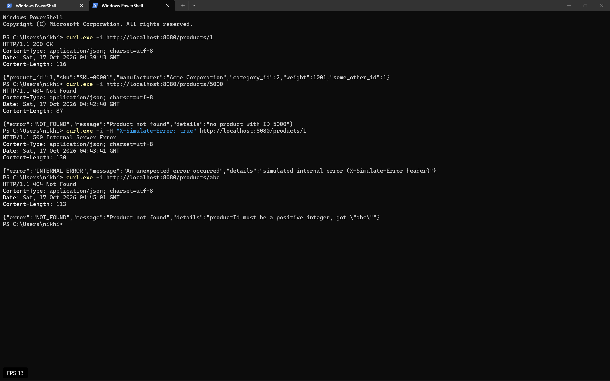
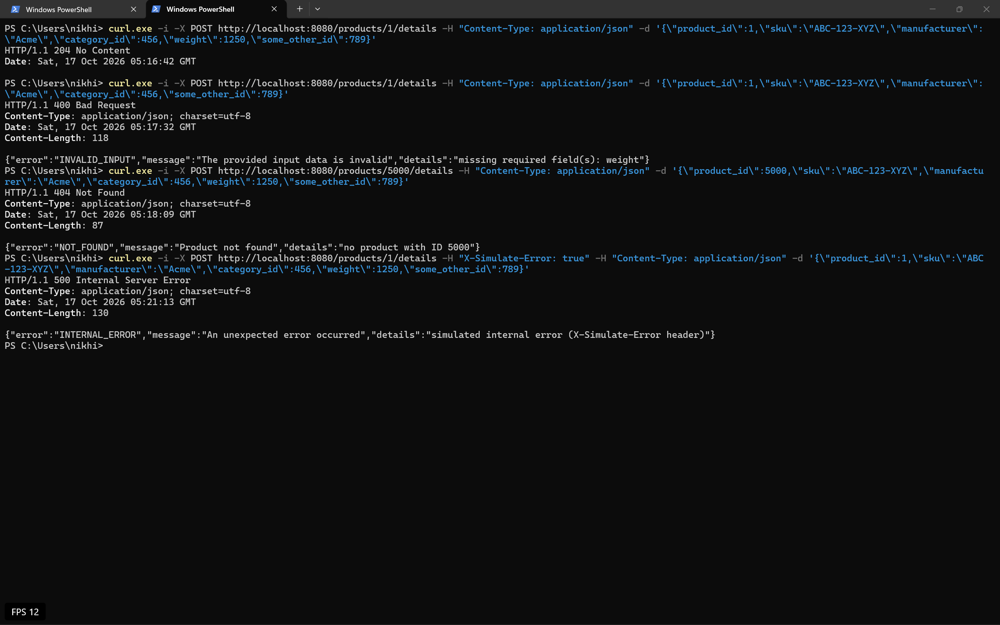

In Docker:

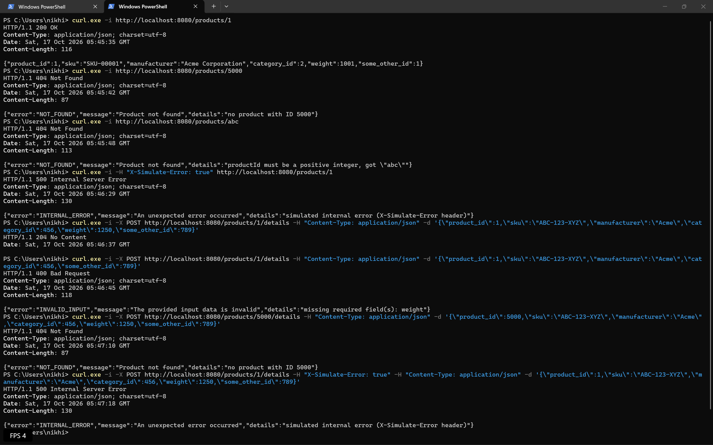

On ECS after terraform apply:

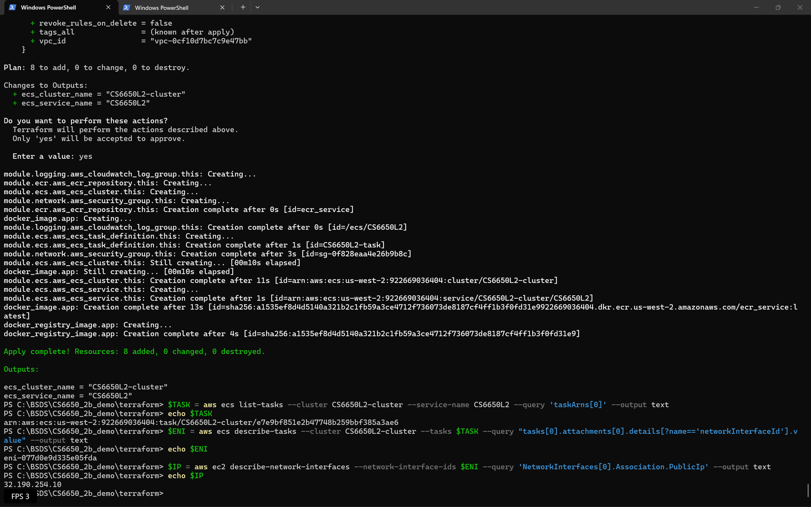
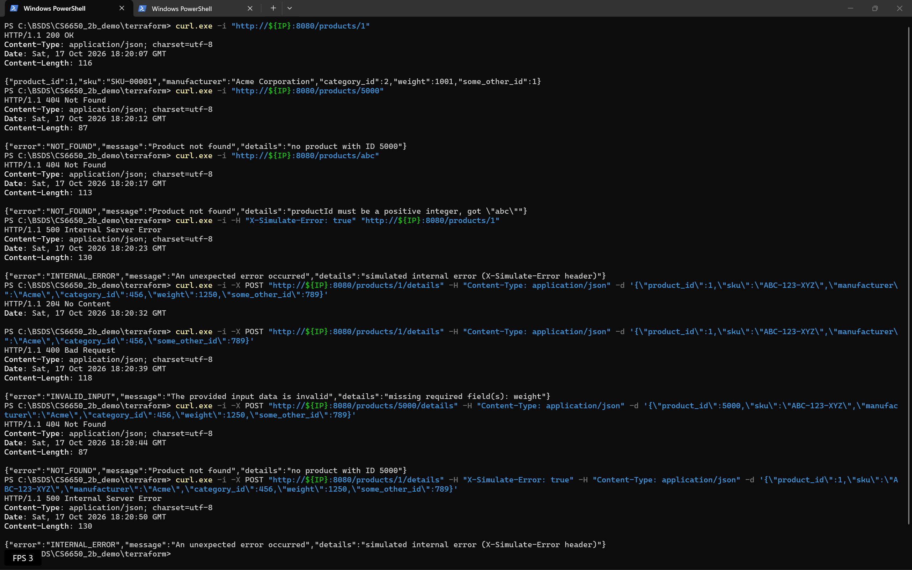

## Load testing

I ran Locust with 4 workers against the deployed server (`cd locust`, set `TARGET_HOST`, then `docker compose up --scale worker=4`). Each user does 9 GETs for every POST on random products from 1 to 1000, because a store gets read a lot more than written.

| Test | Users | RPS | Median | p95 |
|---|---|---|---|---|
| Baseline | 10 | 23 | 87 ms | 150 ms |
| Stress | 1,000 | ~2,160 | 140 ms | 260 ms |
| Stress | 3,000 | ~2,000 | 700 ms | 1,800 ms |
| HttpUser | 200 | 509 | 92 ms | 110 ms |
| FastHttpUser | 200 | 511 | 91 ms | 110 ms |

No failures in any test.

The server started to slow down at around 2,000 requests per second. When I went from 1,000 to 3,000 users, the number of requests only went up by about 9%, but the median time went from 140 ms to 700 ms. The ECS CPU graph showed the CPU at almost 100% of the 0.25 vCPU, so the server could not do more work and the extra users had to wait.

HttpUser and FastHttpUser gave almost the same results. This is because the server and the network decided the speed, not Locust. The difference showed on my laptop. With HttpUser each Locust worker used around 14% CPU, and with FastHttpUser it was around 6.5%. FastHttpUser uses a lighter HTTP library, so the same laptop can send more load with it.

In a real store, GET would be the most common request. That is why I used a read-write lock, because many reads can happen at the same time and only a POST needs to wait.

Baseline with 10 users. Response times are mostly the network from Boston to Oregon:


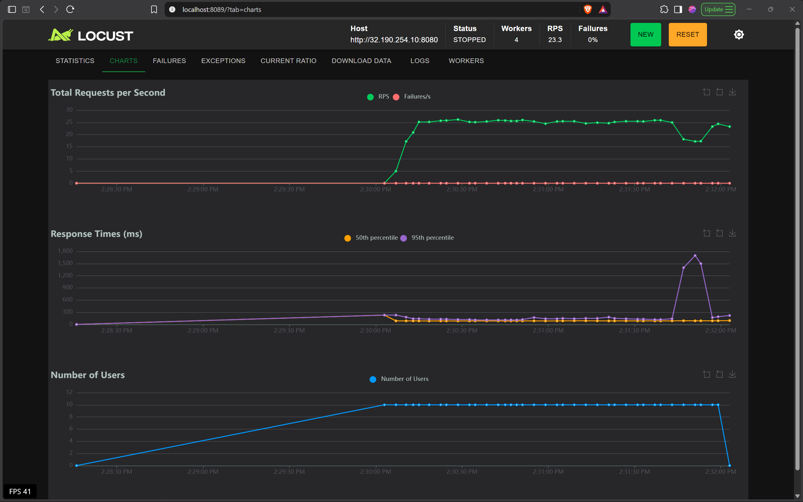

Stress test up to 1,000 users. Requests per second keep rising and response times go up a little:


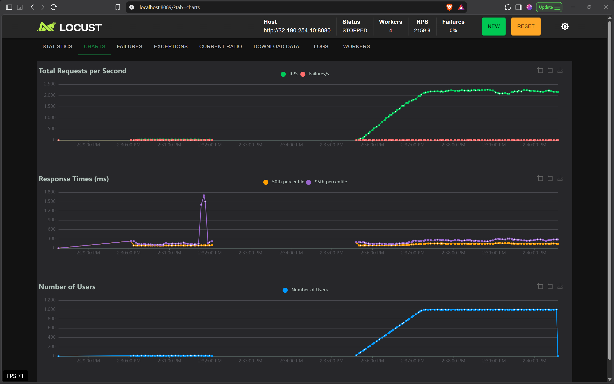

Stress test up to 3,000 users. Requests per second stop rising and response times jump:

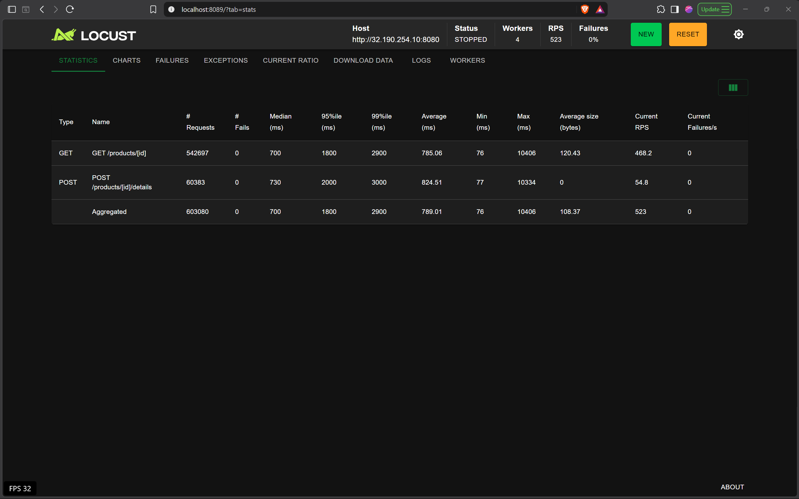
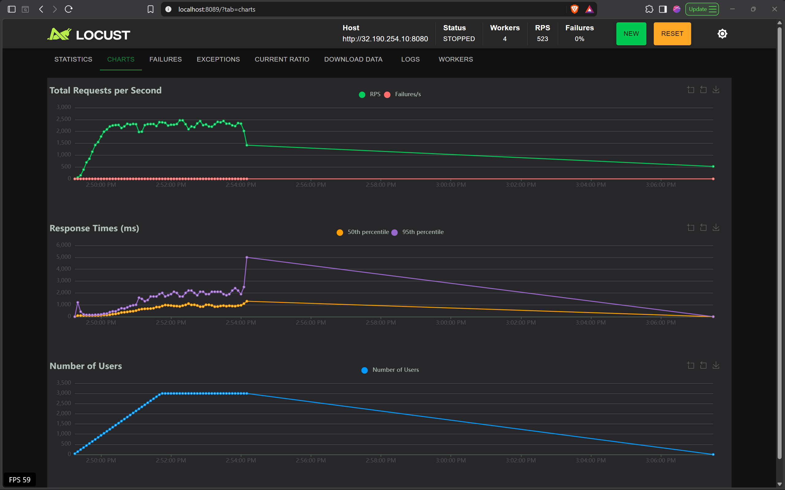

ECS CPU during the two stress tests. The maximum hits about 100%:

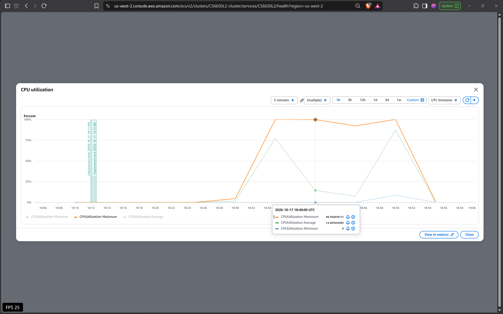

HttpUser and FastHttpUser with 200 users each. Same results:

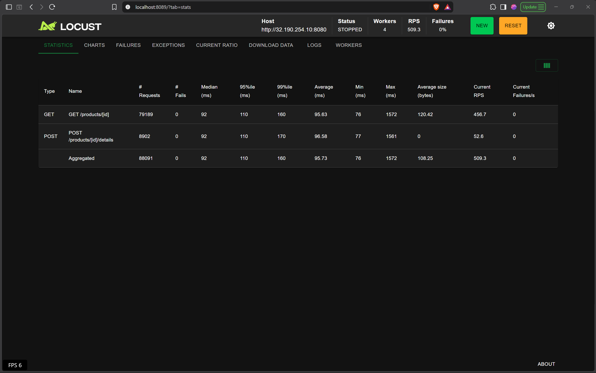


Locust worker CPU for the two runs, about 6.5% with FastHttpUser and about 14% with HttpUser:


## Observability

The server has a `/metrics` endpoint with a request counter, an error counter and a duration histogram, and it writes one JSON log line per request.

To run Prometheus and Grafana locally:

```bash
cd observability
docker compose up -d --build
```

Grafana is at http://localhost:3000 under Dashboards, "Product API - RED signals".

To load it, I ran Locust on the same Docker network with `TARGET_HOST=http://app:8080` and `docker compose -f docker-compose.yaml -f docker-compose.local.yaml up --scale worker=4`.

### Idle vs loaded (1,000 users, 3 minutes)

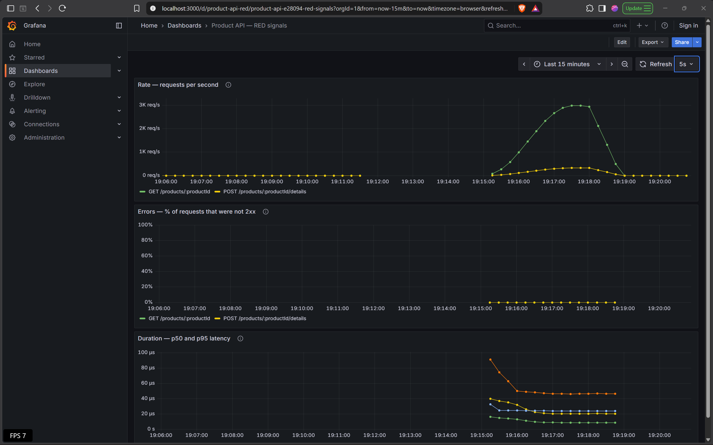


Idle shows no traffic. Under load it went up to about 3,300 requests per second with no errors, and a GET took around 9 µs inside the server.

### Log excerpt from the same run

```json
{"time":"2026-10-17T23:17:55.598997121Z","level":"INFO","msg":"request","method":"GET","endpoint":"/products/:productId","path":"/products/590","status":200,"duration_ms":0.013}
{"time":"2026-10-17T23:17:55.599125296Z","level":"INFO","msg":"request","method":"POST","endpoint":"/products/:productId/details","path":"/products/795/details","status":204,"duration_ms":0.029}
{"time":"2026-10-17T23:17:55.599107763Z","level":"INFO","msg":"request","method":"GET","endpoint":"/products/:productId","path":"/products/87","status":200,"duration_ms":0.01}
{"time":"2026-10-17T23:17:55.600347679Z","level":"INFO","msg":"request","method":"GET","endpoint":"/products/:productId","path":"/products/356","status":200,"duration_ms":0.014}
{"time":"2026-10-17T23:17:55.6004634Z","level":"INFO","msg":"request","method":"POST","endpoint":"/products/:productId/details","path":"/products/359/details","status":204,"duration_ms":0.024}
```

### Dashboard or logs

I'd use the dashboard to see how the server is doing right now, like if traffic, errors or latency went up. I'd use the logs later to find the exact requests that failed or were slow.

### Something I didn't expect

The first time I ran this, my terminal was printing every log line live. Locust showed some requests taking about 20 seconds and only around 320 requests per second, but the dashboard said every request was taking only microseconds. When I started the stack in the background with `-d`, the same test gave around 3,300 requests per second. The terminal was too slow to print so many log lines, so the app had to wait every time it wrote one. The dashboard did not catch this because the timer stops before the log line is written.

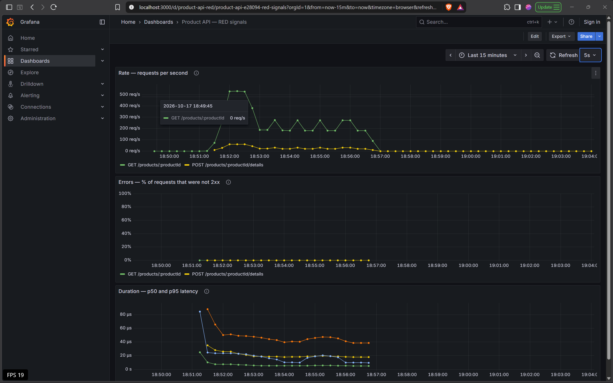
